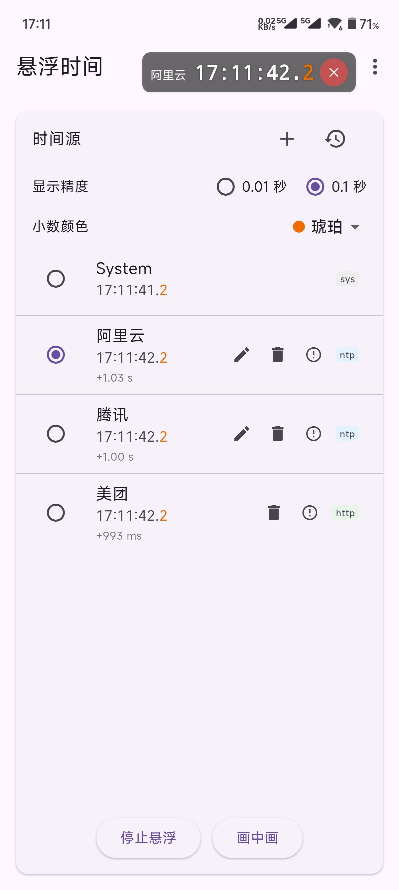
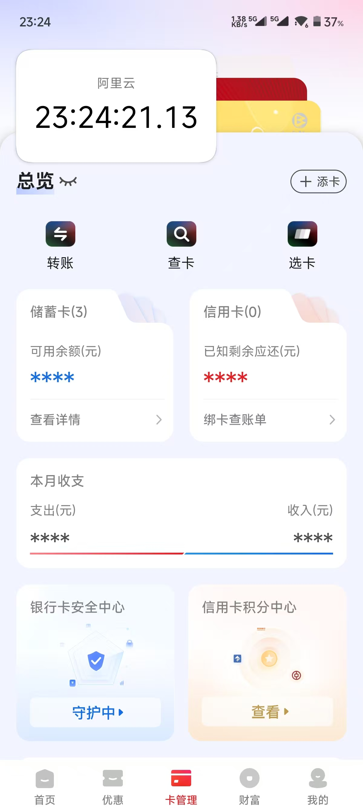

<div align="center">
    <h1>悬浮时间 · FloatingClock</h1>

  <p>
    
    
    
    
    
  </p>

  
  
  <br/>
</div>
<br/>

一个使用 Flutter 编写的轻量级应用，在 Android 上可将一个可拖动的时钟以悬浮窗形式显示在屏幕任意位置，支持多源时间同步与偏差显示。

**主要特性**

- 可在 0.1 秒与 0.01 秒显示精度间切换，并提供多种暗色高亮（默认暗红）用于渲染快速变化的小数位，兼容悬浮窗与画中画显示（例如 `12:34:56.7` / `12:34:56.78`）。
- 可在 Android 上以悬浮窗（Overlay）形式显示，可拖动、固定与关闭。
- 支持多时间源（System、NTP、HTTP 等），并展示与系统时间的偏差（ms）。
- 定期自动同步 NTP/HTTP 时间并保存最近同步记录。
- 支持本地持久化用户添加的时间源（`shared_preferences`）。
- 支持画中画模式（PiP）。

---

## 近期优化（Fork 增强）

本仓库在原始项目基础上做了两项重点优化：

### 1. 修复「悬浮窗三分钟后自动退出」

**根因**：原版将悬浮窗前台服务声明为 `shortService` 类型。Android 14（API 34）起，`shortService` 前台服务**硬限制运行约 3 分钟**，超时系统会回调 `onTimeout` 并判 ANR 杀掉应用，且该类型**不支持粘性重启**——因此每次打开三分钟后就消失且无法自动恢复。

**修复内容**（见 `android/app/src/main/`）：

- 服务类型 `shortService → specialUse`（无运行时长上限、支持 `START_STICKY` 粘性重启），并补齐 `FOREGROUND_SERVICE_SPECIAL_USE` 权限与 `<property>` 用途声明；
- `startForeground()` 显式传入 `FOREGROUND_SERVICE_TYPE_SPECIAL_USE`，并实现 `onTimeout` 兜底，避免个别 ROM 异常时整应用被杀；
- 时间源偏移 / 别名 / 精度 / 小数颜色**持久化到 `SharedPreferences`**，进程被回收后由粘性重启仍能恢复原配置；
- 新增通知栏「停止」动作、通知权限请求、以及**忽略电池优化白名单引导**，降低被厂商后台查杀的概率。

### 2. 界面大厂风重做

- 新增统一设计系统 `lib/theme/app_theme.dart` 与组件库 `lib/widgets/ui_kit.dart`（配色 / 圆角 / 阴影 / 字体全收敛）；
- 首页：深色渐变**实时时钟主卡**（等宽大字 + 小数位高亮 + 状态胶囊 + 偏差标签）、稳定性提示条、卡片化时间源列表（选中态品牌色描边）、渐变分段控件与色卡；
- 关于页：品牌头图 + 功能清单重做；
- **悬浮窗本体重绘**（Kotlin）：深色玻璃胶囊、圆角描边、来源标签、锁定位置按钮、矢量图标，拖动限制在屏幕内。

所有既有业务逻辑（NTP / HTTP 同步、持久化、画中画）保持不变。

---

**代码结构**

- `lib/main.dart`：应用入口，仅负责启动 `MyApp` 并引用具体页面。
- `lib/theme/`、`lib/widgets/`：统一设计系统与可复用 UI 组件（本次新增）。
- `lib/pages/`：`HomePage`、`AboutPage` 等页面及其状态、UI、NTP/HTTP 同步、PlatformChannel、SharedPreferences 等业务逻辑。
- `lib/models/`：定义 `TimePrecision`/`TimeSource` 以及相关序列化与持久化工具，供界面与服务重用。
- `android/app/src/main/kotlin/.../FloatingClockService.kt`：悬浮窗前台服务（修复核心）。
- `test/`：UI 测试位于 `test/widget_test.dart`，使用 `SharedPreferences` mock 并验证关键控件。

---

**运行与测试**

- `flutter pub get`
- `flutter run`
- `flutter test test/widget_test.dart`

**构建 Release APK**

```bash
flutter pub get
flutter build apk --release
# 产物：build/app/outputs/flutter-apk/app-release.apk
```

> 上架前如需正式签名，请在 `android/key.properties` 配置你的签名信息（已在 `.gitignore` 中忽略，不会提交）。

---

**注意事项**

- 悬浮窗需要 **「显示在其他应用上层」** 权限，首次使用会引导你在系统设置中开启。
- 为保证悬浮窗后台不被系统回收，建议在系统「电池优化」中将本应用设为**不受限制 / 允许后台**。
- 本项目将前台服务声明为 `specialUse` 类型：若日后要发布到 **Google Play**，需在 Play Console「应用内容」中申报该前台服务用途。
- 原项目自带的 GitHub Actions 发布工作流未包含在本仓库中（避免需要额外 `workflow` 权限）；如需自动构建 Release，可自行补回 `.github/workflows/` 并授予相应权限。

---

许可证：Apache License 2.0（沿用原项目）。
